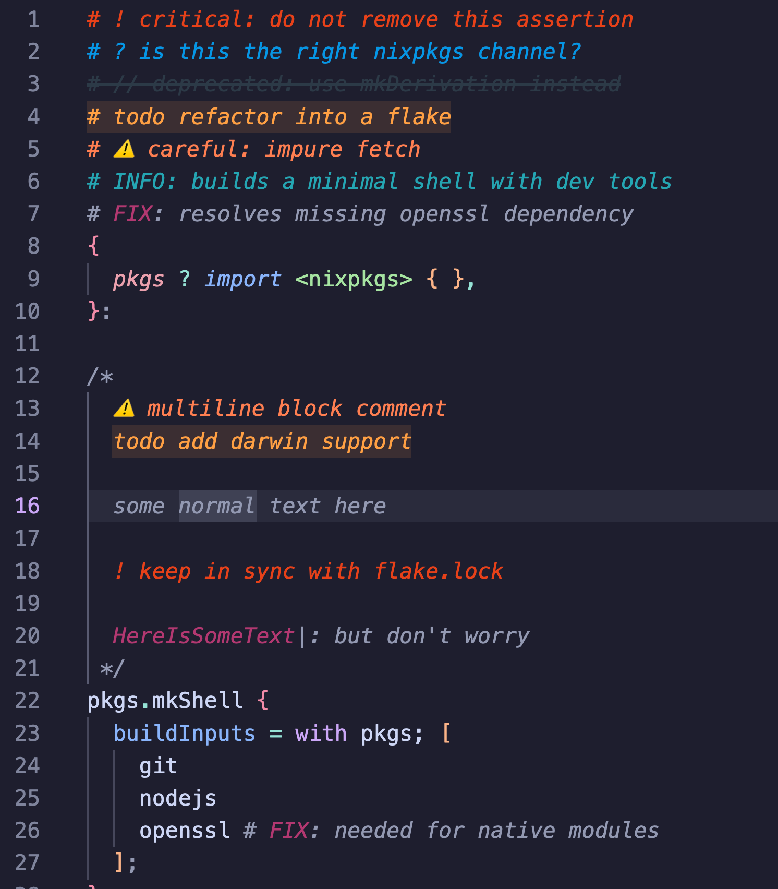

# Colorful Comments (Refreshed)

> A maintained fork of [Colorful Comments](https://marketplace.visualstudio.com/items?itemName=ParthR2031.colorful-comments) — the original hasn't been updated since 2022. This version stays current with new languages and accepts contributions. If you find it useful, a ⭐️ on the marketplace goes a long way!

Categorise your comments by meaning using annotation tags. Each tag gets its own color, making intent scannable at a glance.

| Tag | Color | Default use |
|-----|-------|-------------|
| `!` | Red | Alerts, warnings |
| `?` | Blue | Questions, unclear logic |
| `*` | Green | Highlights, important |
| `^` | Yellow | Caveats, assumptions |
| `&` | Pink | References, links |
| `~` | Purple | Deprecated, revisit |
| `todo` | Mustard | Tasks |
| `//` | Grey + ~~strikethrough~~ | Commented-out code |

All tags, colors, and styles are fully customizable — see [Configuration](#configuration).



---

## Configuration

Settings live in User or Workspace settings under the `colorful-comments-refreshed` prefix.

| Setting | Default | Description |
|---------|---------|-------------|
| `multilineComments` | `true` | Style multiline comments with annotation tags |
| `highlightPlainText` | `false` | Detect tags as first character on a line in plain text files |
| `tags` | *(see below)* | Array of tag definitions |

### Tag schema

Each entry in `tags` accepts:

```jsonc
{
  "tag": "!",                       // trigger string, or regex pattern if isRegex is true
  "color": "#FF2D00",              // text color
  "backgroundColor": "transparent", // highlight behind text
  "strikethrough": false,
  "bold": false,
  "italic": false,
  "isRegex": false                  // treat tag as a regular expression (see below)
}
```

### Regex tags ✨ *new*

Set `"isRegex": true` to match comment annotations with a regular expression instead of a plain string. The `tag` field is then interpreted as a regex pattern tested against the comment text (after the comment delimiter).

```jsonc
"colorful-comments-refreshed.tags": [
    // plain tags — business as usual
    { "tag": "!", "color": "#e84118" },
    { "tag": "todo", "color": "#ff9f43", "backgroundColor": "#ff9f4320" },

    // regex tags — match dynamic patterns
    { "tag": "INFO:.*",        "color": "#22a6b3", "isRegex": true },
    { "tag": "(FIX):\\s.+",    "color": "#B33771", "isRegex": true }
]
```

With the config above:

```js
// INFO: this entire comment is colored         ← matches INFO:.*
// FIX: off-by-one in loop bounds               ← matches (FIX):\s.+
// todo  rewrite this later                     ← matches plain "todo" tag
```

> **Note:** Regex tags are opt-in — existing plain-string tags work exactly as before. Only tags with `"isRegex": true` are compiled as regular expressions.

the following will yield the same results
```json
[
  // I would recommend:
  { "tag": "(FIX):\\s.+", "color": "#B33771", "isRegex": true },
  // or you could use this: (not recommended)
  { "tag": "FIX", "color": "#B33771", "isRegex": true },
]
```

<details>
<summary><b>Default tags (JSON)</b></summary>

```json
[
  { "tag": "!",    "color": "#FF2D00", "strikethrough": false, "backgroundColor": "transparent", "bold": false, "italic": false },
  { "tag": "?",    "color": "#0076FF", "strikethrough": false, "backgroundColor": "transparent", "bold": false, "italic": false },
  { "tag": "//",   "color": "#474747", "strikethrough": true,  "backgroundColor": "transparent", "bold": false, "italic": false },
  { "tag": "^",    "color": "#EAF622", "strikethrough": false, "backgroundColor": "transparent", "bold": false, "italic": false },
  { "tag": "*",    "color": "#28FF00", "strikethrough": false, "backgroundColor": "transparent", "bold": false, "italic": false },
  { "tag": "&",    "color": "#FF06A0", "strikethrough": false, "backgroundColor": "transparent", "bold": false, "italic": false },
  { "tag": "~",    "color": "#BE00FF", "strikethrough": false, "backgroundColor": "transparent", "bold": false, "italic": false },
  { "tag": "todo", "color": "#FF8C00", "strikethrough": false, "backgroundColor": "transparent", "bold": false, "italic": false }
]
```

</details>

<details>
<summary><b>Example: emoji-based tags (@code-instable)</b></summary>

```json
[
  { "tag": "//", "color": "#2C3A47", "strikethrough": true,  "backgroundColor": "transparent" },
  { "tag": "!",  "color": "#e84118", "strikethrough": false, "backgroundColor": "transparent" },
  { "tag": "?",  "color": "#0097e6", "strikethrough": false, "backgroundColor": "transparent" },
  { "tag": "~",  "color": "#FC427B", "strikethrough": false, "backgroundColor": "transparent" },
  { "tag": "*",  "color": "#58B19F", "strikethrough": false, "backgroundColor": "transparent" },
  { "tag": "&",  "color": "#22a6b3", "strikethrough": false, "backgroundColor": "transparent" },
  { "tag": ">",  "color": "#686de0", "strikethrough": false, "backgroundColor": "transparent" },
  { "tag": "$",  "color": "#ff7f50", "strikethrough": false, "backgroundColor": "transparent" },
  { "tag": "⚠️", "color": "#ff7f50", "strikethrough": false, "backgroundColor": "transparent" },
  { "tag": "💡", "color": "#ff9f43", "strikethrough": false, "backgroundColor": "transparent" },
  { "tag": "✅", "color": "#58B19F", "strikethrough": false, "backgroundColor": "transparent" },
  { "tag": "🔎", "color": "#5352ed", "strikethrough": false, "backgroundColor": "transparent" },
  { "tag": "❌", "color": "#e84118", "strikethrough": false, "backgroundColor": "transparent" }
]
```

</details>

<details>
<summary><b>Example: with Regular Expression matching</b></summary>

```json
"colorful-comments-refreshed.tags": [
    { "tag": "!", "color": "#e84118" },
    { "tag": "?", "color": "#0097e6" },
    { "tag": "//", "color": "#2C3A47", "strikethrough": true },
    { "tag": "todo", "color": "#ff9f43", "backgroundColor": "#ff9f4320" },
    { "tag": "⚠️", "color": "#ff7f50" },
    { "tag": "INFO:.*", "color": "#22a6b3", "isRegex": true },
    { "tag": "(FIX):\\s.+", "color": "#B33771", "isRegex": true },
    ]
```

</details>

---

## Supported Languages

See the full list in [`implemented_languages.md`](implemented_languages.md).

### Requesting a new language

[Open an issue with the **language support** label.](https://github.com/allemand-instable/colorful-comments-refreshed/issues)

To speed things up, include the YAML config for your language (lives in `src/parser/data/languageConfig.yaml`).

### Language config reference

Every language builds on a shared base and adds comment-related fields:

```yaml
base: &base
  supportedLanguage: true
  ignoreFirstLine: false
  isPlainText: false
```

| Field | Type | When to use |
|-------|------|-------------|
| `delimiter` | `string` | Single-line comment only (e.g. `"#"` for R, Shell) |
| `commentFormat` | `string[]` | Single + multiline: `[single, open, close]` (e.g. `["//", "/*", "*/"]`) |
| `escapeRegExp` | `string` | When the delimiter needs regex-escaping (e.g. `"*>"` for COBOL) |
| `highlightJSDoc` | `bool` | Enable JSDoc-style highlight |
| `ignoreFirstLine` | `bool` | Skip first line (shebangs, etc.) |

TypeScript interface for completeness:

```ts
interface LanguageConfig {
  delimiter?: string;
  commentFormat?: string[];
  escapeRegExp?: string;
  highlightJSDoc?: boolean;
  ignoreFirstLine: boolean;
  isPlainText: boolean;
  supportedLanguage: boolean;
}
```

<details>
<summary><b>Examples</b></summary>

**Single delimiter** — R, Shell, etc.:
```yaml
hash_delim: &hash_delim
  <<: *base
  delimiter: "#"
```

**Single + multiline** — Python:
```yaml
python_delim: &python_delim
  <<: *base
  commentFormat: ["#", '"""', '""""']
  ignoreFirstLine: true
```

**HTML-style:**
```yaml
html_format: &html_format
  <<: *base
  commentFormat: ["<!--", "<!--", "-->"]
```

**Regex-escaped delimiter** — COBOL:
```yaml
cobol_delim: &cobol_delim
  <<: *base
  escapeRegExp: "*>"
```

</details>


---

## Development

### Prerequisites

Python 3 with `pyyaml`, Node.js with `npm` (or `pnpm`), and [`just`](https://github.com/casey/just) as the task runner.

```bash
just setup            # install vsce, typescript, and dev dependencies
```

### Source of truth

**`package.yaml`** is the canonical source for extension metadata — `package.json` is generated from it and should not be edited by hand. Similarly, language definitions live in `src/parser/data/languageConfig.yaml` and are compiled to TypeScript.

### Build & package

```bash
just compile           # generate package.json + languageConfig.ts, then tsc + eslint
just package           # compile + produce .vsix in vsix/
```

### Scripts

All scripts live in `scripts/` and are called through `just` recipes, but can also be run standalone.

| Script | Recipe | What it does |
|--------|--------|--------------|
| `convert_packages_yaml.py` | `just gen-pkg` | Converts `package.yaml` → `package.json` with round-trip parity check |
| `convert_packages_json.py` | — | Reverse direction: `package.json` → `package.yaml` (one-time bootstrap) |
| `gen_ts_language_config.py` | `just gen-ts` | Converts `languageConfig.yaml` → `src/languageConfig.ts` with typed interface |
| `gen_implemented_languages.py` | — | Reads `activationEvents` from `package.yaml` and writes `implemented_languages.md` |
| `sync_package_json.py` | — | Interactive: syncs language config → `package.json` activation events with semver bump prompt |

### Other recipes

| Recipe | Description |
|--------|-------------|
| `just languages` | Print all implemented languages from the YAML config |
| `just verify` | Regenerate `package.json` and verify parity with `package.yaml` |
| `just clean` | Remove `out/` and `vsix/` build artifacts |
